<div align="center">

# Showdown

### Two people. One seat. Watch the database decide who gets it.

A cinema booking site whose real job is to make **database concurrency control visible**:
two customers click the same seat at the same moment, and you watch PostgreSQL lock, wait, refuse,
deadlock, or (with protection off) double-book it, live.


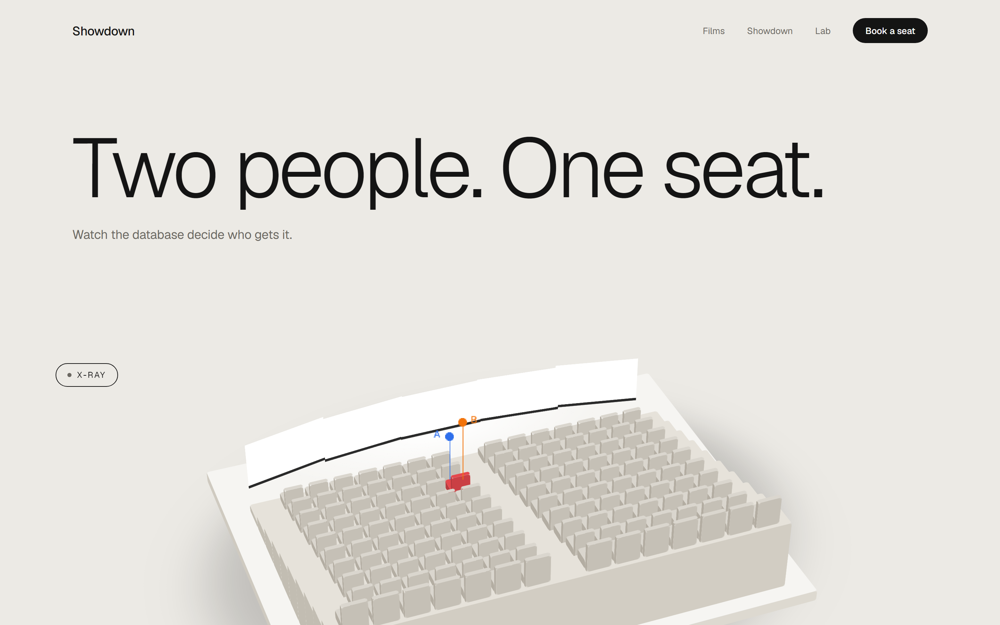

</div>

---

## The idea

Every database course teaches the *lost update*, *two-phase locking* and *deadlocks* on a whiteboard.
Showdown puts them on a screen. It is a real booking site (films, showtimes, a 3D seat map, hold and pay),
but every customer window holds **its own dedicated PostgreSQL connection**, so the locks, the waiting and
the deadlocks are not animations: they happen inside PostgreSQL, and the **X-Ray** view shows you the SQL,
`pg_locks` and the result as they happen.

<div align="center">

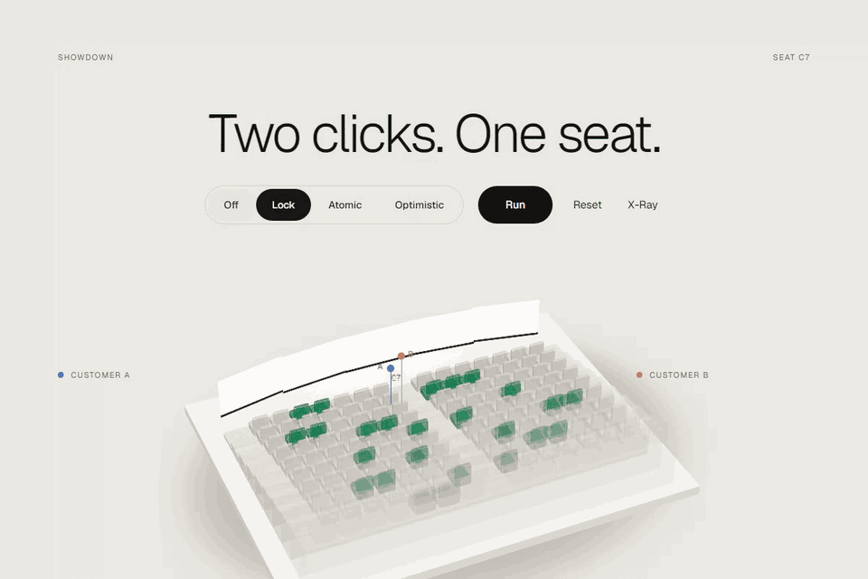

</div>

## Four ways to protect one seat

Flip the protection switch and run the same race again. Same seat, same two clicks, four different outcomes.

| Mode | What the transaction does | Outcome |
|---|---|---|
| **Off** | `SELECT status …` then `UPDATE … SET status='BOOKED'` with no check | Both customers are told "Booked". **Lost update, double booking.** |
| **Lock** | `SELECT … FOR UPDATE` (pessimistic, two-phase locking) | B **waits** on A's row lock, then sees the seat is taken. |
| **Atomic** | `UPDATE show_seat … WHERE status = 'FREE'` | One statement decides. B gets **0 rows** and is refused, no waiting. |
| **Optimistic** | `UPDATE … SET version = v + 1 WHERE version = v` | B's version check fails, it **retries**, the seat is gone. |

<table>
<tr>
<td width="50%">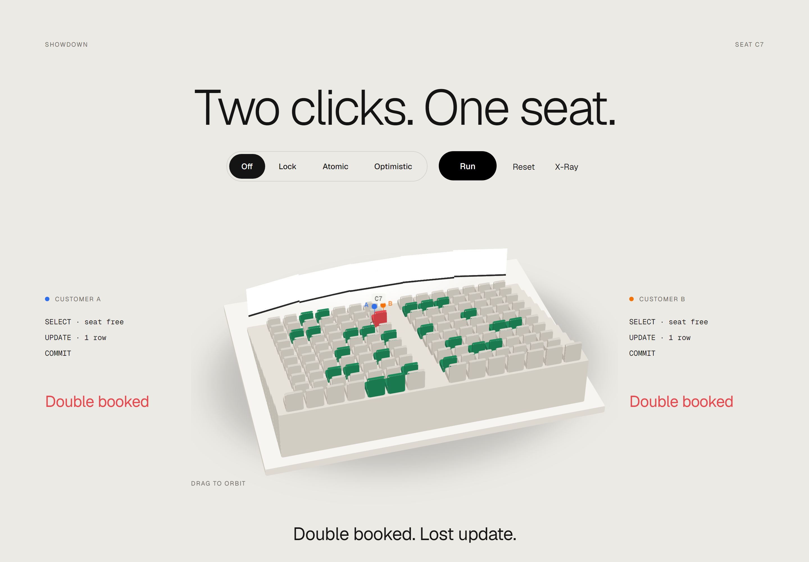<br><sub><b>Off</b>: both commit. The seat is sold twice.</sub></td>
<td width="50%">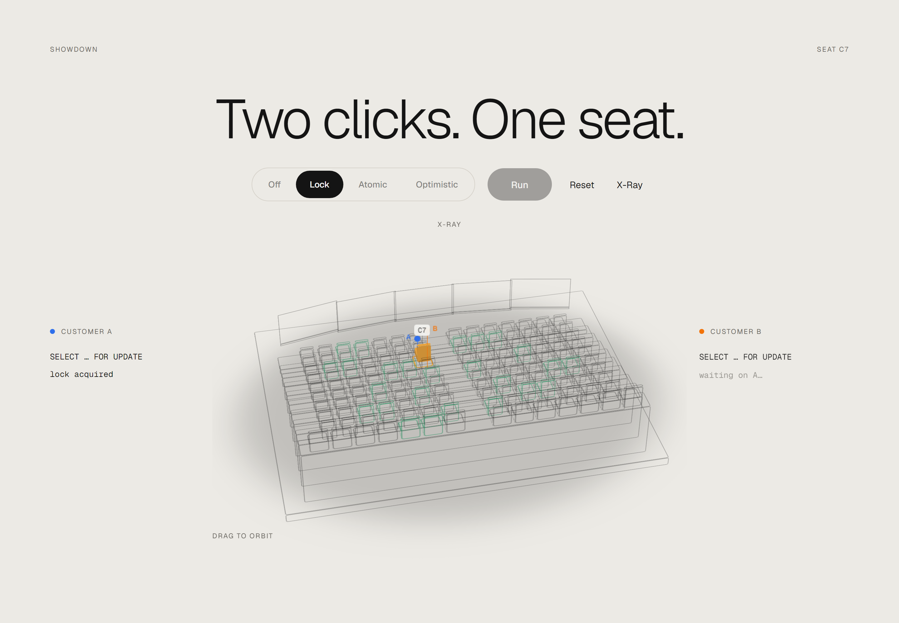<br><sub><b>Lock</b>: B is blocked by A's <code>FOR UPDATE</code>, visible in <code>pg_locks</code>.</sub></td>
</tr>
</table>

## X-Ray

One switch turns the hall into a wireframe. Only the seat in the transaction stays solid, and the SQL each
session sent, the lock it holds or waits on, and the timings appear next to it.

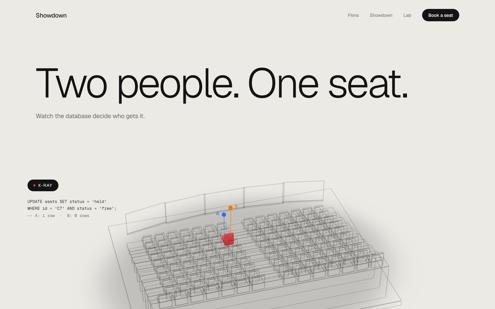

## The Lab

Five exhibits, each a real experiment against the database except the serializability checker, which runs in the browser and says so.

<table>
<tr>
<td width="50%">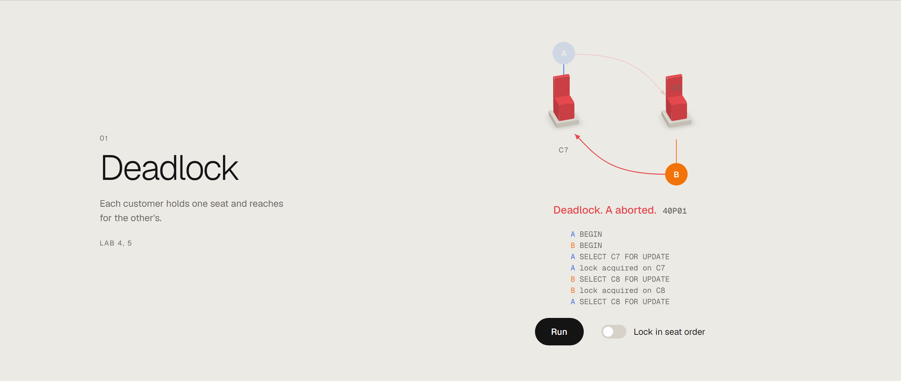<br><sub><b>Deadlock.</b> A locks C7 then C8, B locks C8 then C7. PostgreSQL detects the cycle (<code>40P01</code>) and aborts one. A fixed lock order makes it disappear.</sub></td>
<td width="50%">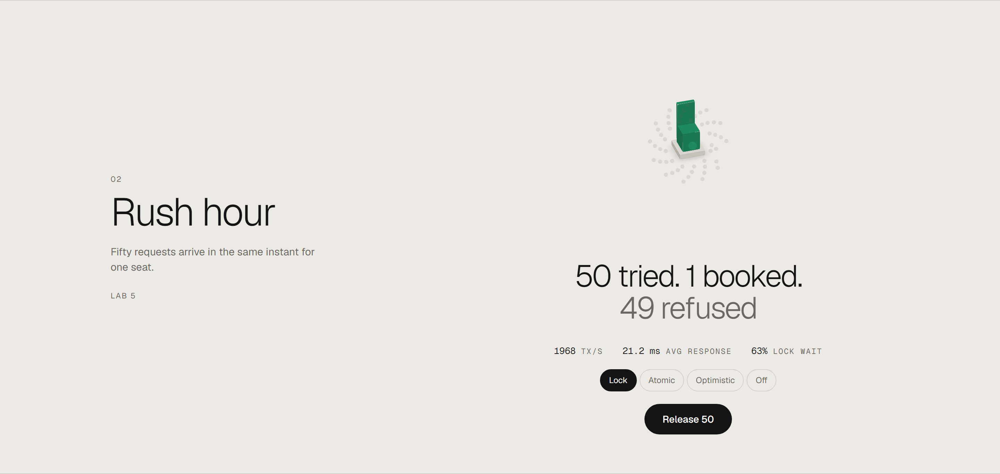<br><sub><b>Rush hour.</b> 50 bots, 50 connections, one seat: exactly 1 booked, 49 refused, with throughput, response time and lock-wait ratio.</sub></td>
</tr>
<tr>
<td width="50%">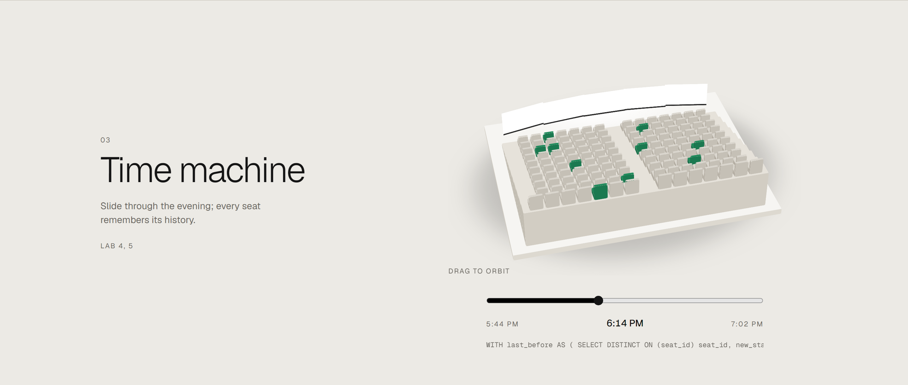<br><sub><b>Time machine.</b> A trigger records every seat change in <code>seat_history</code>; the slider rebuilds the hall at any past moment (a snapshot read, like Flashback / MVCC).</sub></td>
<td width="50%">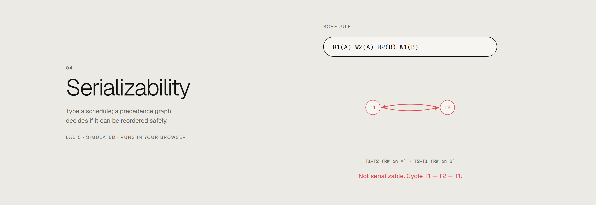<br><sub><b>Serializability.</b> Type a schedule such as <code>R1(A) W2(A) R2(B) W1(B)</code>; get its precedence graph and a verdict.</sub></td>
</tr>
</table>

Plus **Indexes**: the seat search and the sales report run under `EXPLAIN (ANALYZE)` before and after
creating indexes. In the test run, seat search drops from **~18 ms to ~1.8 ms** (Seq Scan → Index Scan) and the
sales report from **~11 ms to ~4.6 ms** (Seq Scan → Index Only Scan).

## Choosing a seat

The hall is a matte 3D model built entirely with CSS 3D transforms (no WebGL): stepped rows, a curved screen,
drag to orbit. Seats update in every open window in real time over WebSockets. Holding seats calls a PL/pgSQL
`book_seats()` function that locks seats in a fixed order; paying uses a transaction with a `SAVEPOINT` per seat,
so a declined card rolls everything back while a single failed seat rolls back only itself.

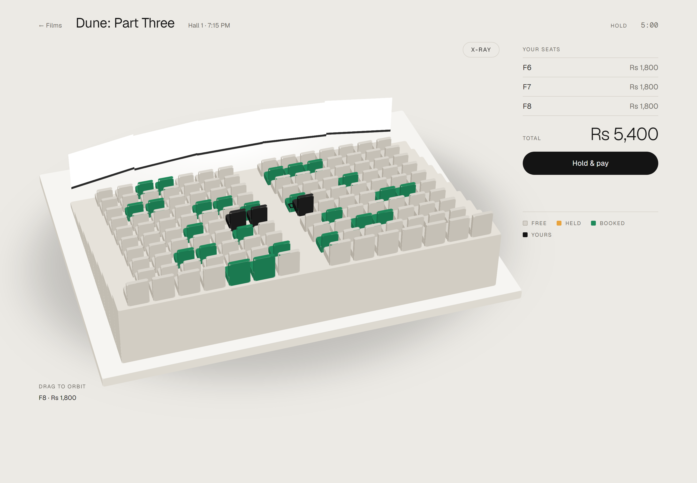

<div align="center">

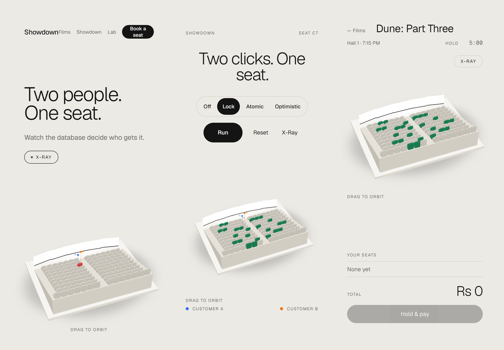

</div>

## How it works

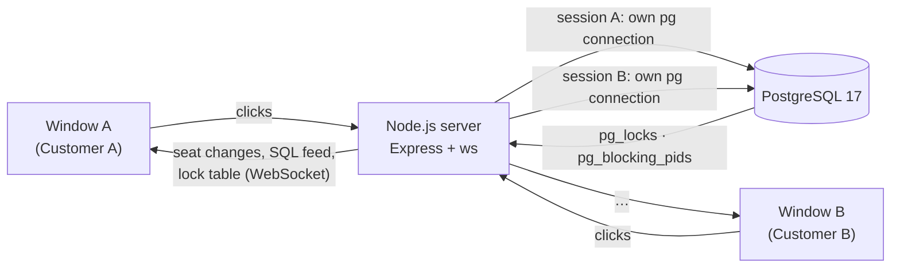

- **One connection per customer.** A transaction can stay open between clicks, so `SELECT … FOR UPDATE`
  genuinely blocks the other session.
- **Real PostgreSQL, no Docker.** `npm install` fetches a PostgreSQL 17 binary
  ([embedded-postgres](https://github.com/leinelissen/embedded-postgres)); it starts and stops with the app.
  Set `DATABASE_URL` to use any other PostgreSQL server instead.
- **9 tables in 3NF**: `movie`, `hall`, `seat`, `showtime`, `customer`, `booking`, `payment`,
  `show_seat` (one row per seat per show: the row that gets locked, with `status`, `held_until`, `version`)
  and `seat_history` (filled by a trigger).

## Run it

Requires **Node.js 20+**. Nothing else.

```bash
npm install
npm run dev        # PostgreSQL + schema + seed + API + WebSocket + Vite → http://localhost:5173
```

| Command | What it does |
|---|---|
| `npm run dev` | Starts everything. The first run seeds ~165,000 `show_seat` rows. |
| `npm test` | 57 tests against a separate real PostgreSQL instance |
| `npm run reset-db` | Drops and re-seeds the database (stop the dev server first) |
| `npm run typecheck` | TypeScript for server, tests and web |

Try the race in two real windows: open `/showdown?show=<id>&customer=A` and `…&customer=B` side by side
(the demo show id is at `/api/demo`). A full five-minute walkthrough is in [docs/VIVA.md](docs/VIVA.md).

## Tested against the real database

The suite does not mock the database: every test runs on an embedded PostgreSQL.

- Off mode **does** produce two confirmed bookings for one seat; Lock, Atomic and Optimistic **never** do.
- In Lock mode, B is observed waiting in `pg_locks` until A commits.
- Unordered locking raises `40P01` and aborts exactly one transaction; ordered locking never deadlocks.
- 50 concurrent connections on one seat: exactly 1 booking, 49 refusals, no leaked connections.
- A declined card rolls back the whole payment; a failed seat rolls back only to its `SAVEPOINT`.
- The trigger writes history for every status change, and the time-machine query rebuilds a past hall.
- Creating the indexes changes the query plan of both measured queries.
- The serializability checker gives the right verdict on known schedules (2 and 3 transactions, cycles, serial order).

<details>
<summary><b>Where each database topic lives in the code</b></summary>

| Topic | Where |
| --- | --- |
| Indexes, `EXPLAIN ANALYZE`, scan types | `db/queries/*.sql`, `db/perf_indexes.sql`, `server/src/lab/perf.ts`, `web/src/pages/lab/Indexes.tsx` |
| Transactions and atomicity | `server/src/hall/hall.ts` `payBooking` (`BEGIN … COMMIT`, full `ROLLBACK` on decline) |
| `SAVEPOINT` | `server/src/hall/hall.ts` `payBooking` (`SAVEPOINT`, `ROLLBACK TO SAVEPOINT`, `RELEASE`) |
| Lost update | Off mode in `server/src/engine/showdown.ts`; `tests/concurrency.test.ts` |
| Exclusive locks, 2PL | Lock mode (`SELECT … FOR UPDATE`); `server/src/engine/locks.ts` reads `pg_locks`, `pg_stat_activity`, `pg_blocking_pids` |
| Deadlock and prevention | `server/src/lab/deadlock.ts`; `book_seats()` locks in label order (`db/02_functions.sql`); `tests/deadlock.test.ts` |
| Snapshot / flashback-style reads | Trigger `trg_show_seat_history` → `seat_history`; `server/src/lab/history.ts` (`DISTINCT ON`) |
| Serializability, precedence graphs | `web/src/lib/serializability.ts`; `tests/serializability.test.ts` |
| Optimistic concurrency | Optimistic mode in `showdown.ts`; `show_seat.version` |
| Throughput, response time, lock-wait ratio | `server/src/lab/rush.ts`; `tests/rush.test.ts` |
| Stored procedures (PL/pgSQL) | `db/02_functions.sql`: `book_seats()`, `release_expired_holds()`, `fn_show_seat_history()` |

</details>

## Project structure

```
db/                 schema, PL/pgSQL functions + trigger, seed, index scripts, the EXPLAIN'd queries
server/src/
  engine/           one session per customer, the four modes, pg_locks reader
  hall/             hold, pay (SAVEPOINT), expiry sweeper
  lab/              deadlock, rush hour, history, query performance
  http/  ws/        REST API and WebSocket hub
  db/               embedded PostgreSQL or DATABASE_URL, migrations
shared/types.ts     types shared by server and web
web/src/            React pages (Home, Films, Movie, Hall, Showdown, Lab) and the CSS 3D hall
tests/              Vitest suites against a real PostgreSQL
docs/               demo script, build contract, README media
```

## Scope

Payments are simulated (decline and fail-one-seat are switches), there is no login, and it runs locally.
Crash recovery (WAL) is out of scope. Movie titles are real 2026 releases used as sample data; all artwork is
original and no posters are used.

## Team

Built as the semester project for **Advanced Database Management Systems** (SEN-410), BS Computer Science,
Bahria University Karachi.

**Moiz Ali** · **Ayesha Aleem** · **Zainab Fatima**
